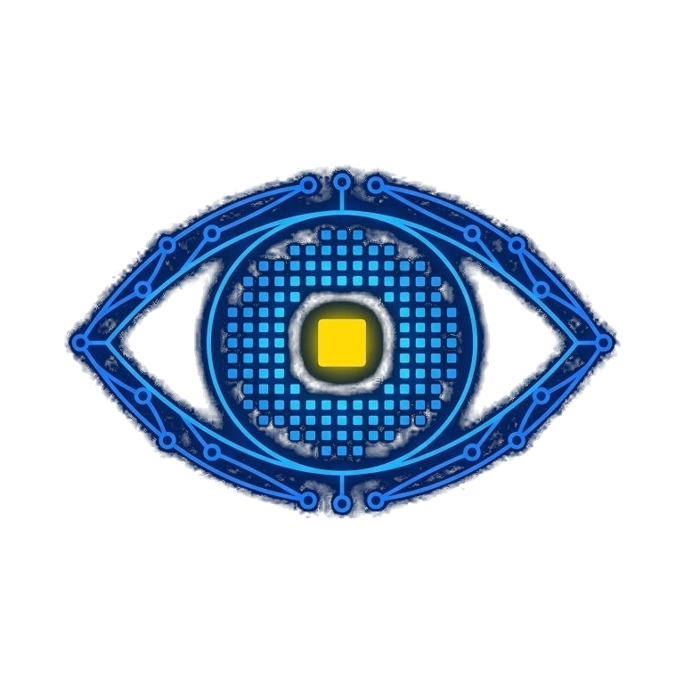
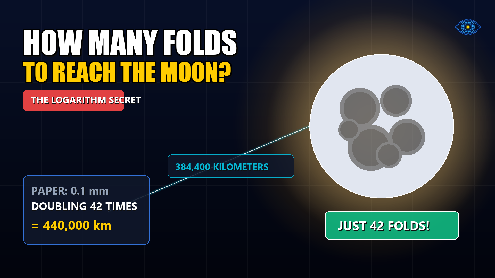
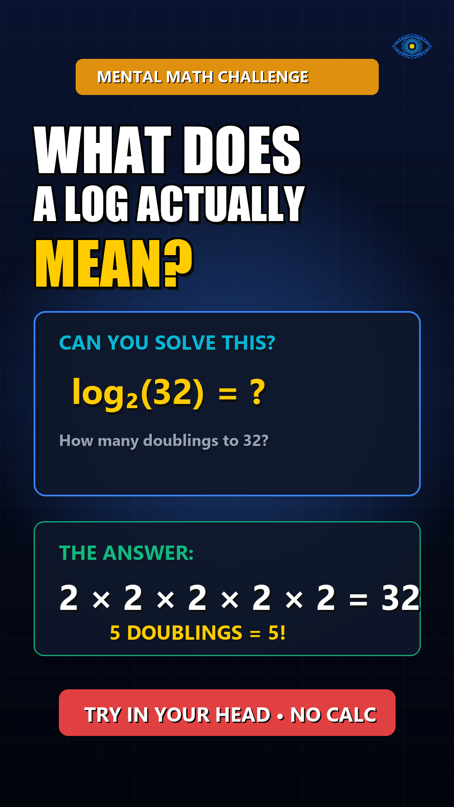
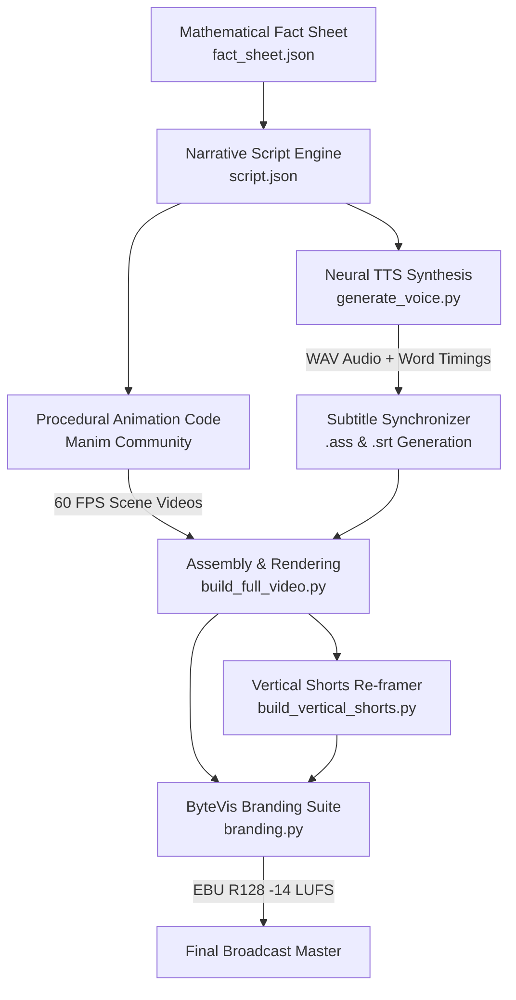

# 📐 What is a Logarithm, Actually? | ByteVis

<p align="center">
  
</p>

<p align="center">
  <strong>An intuitive mathematical exploration and open-source automated video production engine.</strong><br>
  Built with <strong>Manim Community</strong>, <strong>Kokoro Neural TTS</strong>, and <strong>FFmpeg</strong>.
</p>

<p align="center">
  
  
  
  
  
</p>

---

## 🎬 Showcase

| Full Horizontal Explainer (16:9) | Vertical Shorts & Reels (9:16) |
| :---: | :---: |
|  |  |
| *5m 28s deep dive into the inverse machine of math* | *Bite-sized visual proofs & Benford's Law anomaly* |

---

## 🧠 Part 1: What is a Logarithm, Actually?

Most textbooks introduce logarithms through dry, intimidating algebraic formalism:

$$\log_b(x) = y \iff b^y = x$$

While mathematically exact, this definition completely hides the intuitive physical reality. A logarithm is fundamentally simple:

> **A logarithm is an "inversion machine" that counts steps.**<br>
> While multiplication counts repeated addition, and exponentiation counts repeated multiplication, **a logarithm counts how many times you must divide (or double) to traverse an exponential scale.**

---

### 1. The 42-Fold Paper Riddle: Stepping to the Moon

Imagine holding a standard sheet of printing paper. Its thickness is approximately **$0.1\text{ mm}$** ($10^{-4}\text{ m}$).

If you fold it in half:
- **1 fold**: $0.2\text{ mm}$ (2 layers)
- **2 folds**: $0.4\text{ mm}$ (4 layers)
- **3 folds**: $0.8\text{ mm}$ (8 layers)
- **$n$ folds**: $0.1\text{ mm} \times 2^n$

How many folds would it take for the paper stack to reach the **Moon** ($384,400\text{ km}$ away)?

Most human intuition guesses thousands or millions of folds. The real answer is astonishing: **just 42 folds**.

$$\text{Thickness after } 42 \text{ folds} = 0.1\text{ mm} \times 2^{42} \approx 439,804\text{ km}$$

At 42 folds, you overshoot the Moon's average orbit by over $55,000\text{ km}$!

| Fold Count ($n$) | Layers ($2^n$) | Thickness | Real-World Scale |
| :--- | :--- | :--- | :--- |
| **0** | 1 | $0.1\text{ mm}$ | Single page |
| **10** | $1,024$ | $10.2\text{ cm}$ | Width of a human hand |
| **14** | $16,384$ | $1.64\text{ m}$ | Adult human height |
| **20** | $1,048,576$ | $104.9\text{ m}$ | Height of the Statue of Liberty |
| **30** | $1,073,741,824$ | $107.4\text{ km}$ | Outer space (past the Kármán line) |
| **40** | $1,099,511,627,776$ | $109,951\text{ km}$ | Over a quarter of the way to the Moon |
| **41** | $2,199,023,255,552$ | $219,902\text{ km}$ | Past half the distance |
| **42** | $4,398,046,511,104$ | **$439,805\text{ km}$** | **Past the Moon!** 🚀 |

#### The Logarithm as the Question:
- **Exponentiation asks**: *"If I double 42 times, how big is the number?"* $\implies 2^{42} \approx 4.4 \times 10^{12}$.
- **Logarithm asks**: *"If the Moon is $3.844 \times 10^{12}$ paper-thicknesses away, how many doublings get me there?"*

$$\log_2\left(\frac{384,400\text{ km}}{0.1\text{ mm}}\right) = \log_2(3,844,000,000,000) \approx 41.8 \implies \mathbf{42 \text{ folds}}$$

---

### 2. Why Nature Speaks in Logarithms

Our universe does not operate on a linear scale. Natural phenomena span dozens of orders of magnitude. If our perceptions and physical laws were linear, our senses would be overwhelmed and scientific instrumentation would be impossible.

#### A. Earthquakes: The Richter & Moment Magnitude Scale
An earthquake of magnitude 7 is **not** $16\%$ stronger than magnitude 6. The magnitude scale is base-10 logarithmic:
- **Ground Wave Amplitude**: Every $+1$ on the scale is a **$10\times$ increase** in wave amplitude measured on a seismograph. A Magnitude 7 has **$100\times$** the ground displacement of Magnitude 5 ($10^{7-5} = 10^2 = 100$).
- **Energy Released**: The seismic energy $E$ scales with exponent $1.5$:
  $$\frac{E_{M+1}}{E_M} = 10^{1.5} \approx 31.62$$
  A Magnitude 9 earthquake releases **one million times** more destructive energy than a Magnitude 5!

#### B. Sound & Hearing: The Decibel Scale ($dB$)
The quietest sound human ears can register (the threshold of hearing) has an intensity of $I_0 = 10^{-12}\text{ W/m}^2$. A nearby jet engine produces roughly $1\text{ W/m}^2$.

The ratio between them is **$10^{12}$ (one trillion to one)**!

If your hearing were linear, a whisper would be imperceptible or a jet engine would instantly vaporize your eardrum. According to the **Weber-Fechner law**, human sensory perception responds logarithmically:

$$L = 10 \log_{10}\left(\frac{I}{I_0}\right)$$

A whisper is $\approx 30\text{ dB}$, conversational speech is $\approx 60\text{ dB}$, and a rock concert is $\approx 120\text{ dB}$. Every $+10\text{ dB}$ represents a $10\times$ increase in physical sound intensity.

#### C. Acidity & Chemistry: The pH Scale
The concentration of hydronium ions $[H^+]$ in solutions varies from $1\text{ M}$ (extremely caustic acid) to $10^{-14}\text{ M}$ (extreme alkali):

$$\text{pH} = -\log_{10}[H^+]$$

- Stomach acid ($\text{pH } 1$) has $[H^+] = 10^{-1}\text{ M}$.
- Pure water ($\text{pH } 7$) has $[H^+] = 10^{-7}\text{ M}$.
- Stomach acid has **$1,000,000\times$** more active hydrogen ions than neutral water!

---

### 3. Benford's Law: The Logarithmic Secret of the First Digit

If you collect random numbers from the real world—lengths of rivers in miles, population of cities, stock prices, or electricity bills—what fraction of them start with the digit **1**?

If all digits were equally likely, each digit $1 \dots 9$ would appear $\approx 11.1\%$ of the time.

Instead, the digit 1 appears **$30.1\%$** of the time, while the digit 9 appears only **$4.6\%$**!

```
Digit 1: ■■■■■■■■■■■■■■■■■■■■■■■■■■■■■■ 30.1%
Digit 2: ■■■■■■■■■■■■■■■■■ 17.6%
Digit 3: ■■■■■■■■■■■■ 12.5%
Digit 4: ■■■■■■■■■ 9.7%
Digit 5: ■■■■■■■ 7.9%
Digit 6: ■■■■■■ 6.7%
Digit 7: ■■■■■ 5.8%
Digit 8: ■■■■■ 5.1%
Digit 9: ■■■■ 4.6%
```

#### Why?
Multiplicative processes grow exponentially. On a logarithmic ruler from 1 to 10:
$$\text{Width of digit } d = \log_{10}(d + 1) - \log_{10}(d) = \log_{10}\left(1 + \frac{1}{d}\right)$$

- To grow from $1,000$ to $2,000$ requires a **$100\%$ gain** (the stock or population must double).
- To grow from $9,000$ to $10,000$ requires only an **$11.1\%$ gain**.
- Any growing quantity spends **more than six times longer** with a leading digit of 1 than with a leading digit of 9!

---

### 4. The Geometry of the Logarithmic Curve

$$\begin{aligned}
f(x) &= \log_2(x) \\
f'(x) &= \frac{1}{x \ln 2} \\
f''(x) &= -\frac{1}{x^2 \ln 2}
\end{aligned}$$

- **Vertical Asymptote at $x = 0$**: $\lim_{x \to 0^+} \log_2(x) = -\infty$.
- **$x$-intercept at $(1, 0)$**: You need zero doublings to stay at 1.
- **Infinite Crawl**: Because $f''(x) < 0$ everywhere, the curve is strictly concave downward. It flattens out dramatically as $x \to \infty$, yet it **never stops growing**. To add just $+1$ to your output, you must **double your input**.

---

## 🛠️ Part 2: How We Built It (Automated Production Engine)

This project is not just a math explainer—it is an **end-to-end, automated programmatic video generation studio**. Every animation frame, voiceover word, subtitle token, audio normalization pass, and branding element was built through code.



---

### Key Architectural Modules

#### 1. `fact_sheet.json` & `fact_check.py`
Before rendering a single pixel, every mathematical formula, exponent, and unit conversion is defined in a structured JSON fact bank and validated programmatically via Python assertions. This guarantees zero mathematical errors or misleading charts.

#### 2. `common.py`: Design Tokens & Visual Hierarchy
To achieve a modern, aesthetic look that stands out from typical generic animations, we implemented a custom design system:
- **Background**: Deep obsidian navy (`#0B0F19`)
- **Accent 1 (Focus / Electric)**: Neon Cyan (`#00E5FF`)
- **Accent 2 (Highlight / Insight)**: Radiant Gold (`#FFD700`)
- **Accent 3 (Contrast / Warning)**: Vibrant Coral (`#FF5252`)
- **Accent 4 (Success / Growth)**: Mint Green (`#00E676`)
- **Typography**: Clean, sans-serif mathematical typography paired with Computer Modern $\LaTeX$ rendering.

#### 3. `generate_voice.py`: Kokoro 82M Neural Voice
Uses the lightweight, high-fidelity Kokoro TTS engine (`af_heart` voice checkpoint) to synthesize clear, natural educational narration. The engine outputs per-sentence audio files alongside word-level duration manifests.

#### 4. `scenes/*.py`: 39 Procedural Manim Scenes
From the opening question hook (`scene_01_hook.py`) to the log graph zoom (`scene_30_log_graph.py`) and Benford distribution (`scene_34_benford_law.py`), each section is modeled as an independent, reproducible Manim scene class that compiles cleanly to 1080p60.

#### 5. `branding.py`: Studio Watermarking & Loudness Normalization
A dedicated post-processing CLI that:
- Adds a semi-transparent, anti-aliased ByteVis logo watermark to the top-right corner.
- Generates and attaches animated 2.5-second CTA end-cards (YouTube "Subscribe", Instagram "Follow").
- Implements two-pass **EBU R128 audio normalization** using `ffmpeg-loudnorm`, targeting **-14.0 LUFS integrated loudness**, **-1.0 dBTP true peak**, and **11.0 LU loudness range** (strict compliance with YouTube and Instagram audio standards).

#### 6. `build_vertical_shorts.py`: Smart 9:16 Re-framing
Automatically slices, re-frames, crops, and centers horizontal 16:9 animations into high-impact 9:16 vertical shorts, re-positioning subtitles to avoid UI button overlaps on TikTok, YouTube Shorts, and Instagram Reels.

#### 7. `create_thumbnails.py`: Programmatic Thumbnail Generation
Renders high-contrast, mathematically provocative thumbnail artwork in both 1920x1080 (YouTube full) and 1080x1920 (Shorts cover) formats.

---

## 📂 Repository Structure

```
bytevis-logarithm/
│
├── README.md                      # Comprehensive math guide and engine documentation
├── requirements.txt               # Python package dependencies
├── LICENSE                        # MIT License
├── .gitignore                     # Excludes heavy video/audio binaries & render caches
│
├── create_thumbnails.py           # Programmatic thumbnail generator (16:9 and 9:16)
├── organize_project_videos.py     # Production distribution organizer
│
├── logo/                          # Official ByteVis branding assets
│   ├── ByteVis_eye_logo_transparent.png
│   └── ByteVis_eye_logo_no_text.png
│
├── short video plan/              # Shorts production manifests
│   ├── clips_plan.json            # Exact timestamps and crop regions for shorts
│   └── shorts_brief.md            # Editorial hook strategy for vertical content
│
├── videos/                        # Publishing catalog & caption manifests
│   ├── posting_map.txt            # Complete publishing registry (titles, tags, durations)
│   ├── 01_full_video_what_is_a_log/
│   │   ├── captions.ass / .srt    # Word-timed subtitles
│   │   ├── chapters.txt           # YouTube chapter timestamps
│   │   ├── info.txt               # Video metadata & SEO tags
│   │   └── thumbnail.png          # 1920x1080 artwork
│   ├── 02_short_what_does_a_log_mean/
│   ├── 03_short_why_numbers_start_with_1/
│   ├── 04_short_earthquakes_ph_sound/
│   ├── 05_short_the_log_graph/
│   └── 06_short_paper_to_moon_native_explainer/
│
└── log_full/                      # Core animation and assembly source code
    ├── common.py                  # Design palette, typography, and layout primitives
    ├── branding.py                # Watermark injection, end-cards, and -14 LUFS normalizer
    ├── build_full_video.py        # FFmpeg scene stitcher & subtitle burner
    ├── build_vertical_shorts.py   # 9:16 vertical video re-framing pipeline
    ├── generate_voice.py          # Kokoro TTS narration synthesizer
    ├── generate_end_voices.py     # Voice synthesis for outro CTAs
    ├── render_all_sections.py     # Automated batch Manim scene renderer
    ├── render_end_cards.py        # Manim end-card scenes renderer
    ├── run_final_qc.py            # Quality control validator (framerate, audio sync)
    ├── script.json                # Complete narration script and timings
    ├── fact_sheet.json            # Verified mathematical constants and equations
    ├── storyboard.md              # Scene-by-scene visual storyboard
    │
    ├── assets/                    # Assets used in video assembly (watermark logo)
    ├── scenes/                    # 39 modular Manim scene animation scripts
    └── short_video/               # Native vertical Manim animation scripts
```

---

## 🚀 Getting Started & Local Reproduction

### 1. Prerequisites

Ensure you have the following installed on your machine:
- **Python 3.10+**
- **FFmpeg 5.0+** (with `libass` support for subtitle burning)
- **LaTeX** (Optional, recommended for math typesetting in Manim: TeX Live / MiKTeX)

Verify installations:
```bash
python --version
ffmpeg -version
```

### 2. Installation

Clone this repository and install Python dependencies:
```bash
git clone https://github.com/bytevis/logarithm.git
cd logarithm
pip install -r requirements.txt
```

### 3. Generate Narration Audio
Synthesize voiceover files using Kokoro TTS:
```bash
cd log_full
python generate_voice.py
python generate_end_voices.py
```

### 4. Render Animation Scenes
Render all 39 mathematical animation scenes using Manim:
```bash
# In directory: log_full/
python render_all_sections.py
python render_end_cards.py
```

### 5. Assemble Full Video & Subtitles
Stitch the scenes, mix audio, and burn glowing word-timed subtitles:
```bash
python build_full_video.py
```

### 6. Build Vertical Shorts
Re-frame and render the 9:16 vertical shorts:
```bash
python build_vertical_shorts.py
```

### 7. Run Final Branding Pass
Apply watermarks, attach end cards, and normalize audio to -14 LUFS:
```bash
python branding.py
python run_final_qc.py
```

### 8. Generate Thumbnails
Produce crisp, high-CTR thumbnails for all videos:
```bash
# In repository root
python create_thumbnails.py
```

---

## 📊 Video Catalog

| # | Video Title | Format | Duration | Primary Hook |
| :--- | :--- | :---: | :---: | :--- |
| **01** | **What is a Logarithm, Actually?** | 16:9 | 5m 28s | The 42-fold moon puzzle & universe scales |
| **02** | **What Does a Logarithm Actually Mean?** | 9:16 | 38s | The "inversion machine" counting doublings |
| **03** | **Why Most Numbers in the Universe Start with 1** | 9:16 | 54s | Benford's Law explained with a log ruler |
| **04** | **Earthquakes, pH & Sound: Nature's Secret Scale** | 9:16 | 45s | Why Magnitude 7 is $100\times$ stronger than 5 |
| **05** | **The Log Graph: The Infinite Crawl** | 9:16 | 47s | The curve that slows down but never stops |
| **06** | **How 42 Folds of Paper Reach the Moon** | 9:16 | 75s | Native vertical exponential counter explainer |

---

## 📜 License

This project is open-source under the [MIT License](LICENSE). Feel free to use the animation code, educational concepts, and pipeline architecture in your own mathematical projects!

<p align="center">
  Made with ❤️ by <strong>ByteVis</strong> — <em>Math, Visualized.</em>
</p>
